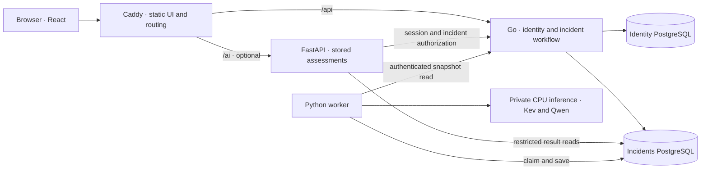

# CyberGuard

A self-hosted application for reporting, investigating, and resolving
cybersecurity incidents. Employees follow their own reports, analysts work the
incident queue, and administrators manage accounts and assignment. Optional AI
produces advisory assessments; it does not take response actions or decide outcomes.

## Try it locally

Start with the core app on **Linux or WSL2**. You need Git, a running Docker
engine with Compose v2, GNU Make, OpenSSL and jq. Go, Node.js and Python are not
required on the host. The first build needs internet access.

For a fresh demo, run these commands in Bash:

```bash
git clone https://github.com/bekadoux/cyberguard.git
cd cyberguard

export DOCKER_SECRET_GID="$(id -g)"
make docker-secrets
make docker-build
make docker-db-up
make docker-bootstrap
make docker-migrate
make docker-seed-demo
make docker-up
```

Open **[http://127.0.0.1:8088/login](http://127.0.0.1:8088/login)** and sign in
as **`admin`**. Read the generated demo password in a private terminal:

```bash
cat .local/docker-secrets/dev_admin_password
```

Use `make docker-down` to stop without deleting data, and `make docker-up` to
restart from the same shell with `DOCKER_SECRET_GID` set. Keep the database
volumes and `.local/docker-secrets/` together; do not regenerate secrets or
remove volumes for an existing installation. See the
[local Docker guide](docs/docker-setup.md) for more options.

> The local setup uses HTTP and demo accounts. Use synthetic data and do not
> expose it to the internet.

### Try it with AI

On Linux amd64, run `bash docker/local-setup.sh` from the checkout to set up a
**separate** local stack. Follow the prompts to seed demo accounts and prepare
about 3 GB of model files. Use the URL and credentials printed by the installer.
Stop the core stack first if both use port `8088`. For prerequisites, restart
commands, and how to add AI to an existing local stack, see the
[local AI guide](docs/docker-setup.md#one-command-setup-with-real-ai).

## Deploy on a server

- **Application only:** follow the [application VM guide](docs/azure-app-deployment.md)
  to set up HTTPS and persistent databases on an Ubuntu 26.04 amd64 VM.
- **Application with AI:** follow the [two-VM Azure guide](docs/remote-setup.md)
  to prepare the servers, configure networking and TLS, and deploy over SSH.

For a real installation, [create the first owner](docs/azure-app-deployment.md#initialize-the-application-owner)
instead of seeding demo accounts. Sign in at `https://<your-domain>/login`.
Employee self-registration is disabled by default and currently available only
through the API when explicitly enabled. For an existing deployment, follow the
[upgrade procedure](docs/azure-app-deployment.md#6-maintenance-upgrades-and-protected-backups)
instead of repeating fresh setup.

## Architecture



[Frontend](docs/frontend.md) · [Go API](docs/go-backend.md) ·
[Database setup](docs/database-setup.md) · [AI service](docs/ai-backend.md) ·
[Deployment](docs/deployment.md) · [Backlog](docs/backlog.md)

Domain specification: [English](docs/domain-specification.md) ·
[Slovak](docs/domain-specification.sk.md).
