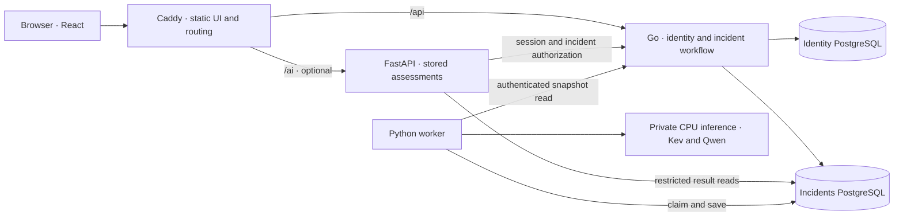

# CyberGuard

A self-hosted application for reporting, investigating, and resolving
cybersecurity incidents. Employees follow their own reports, analysts work the
incident queue, and administrators manage accounts and assignment. Optional AI
produces advisory assessments; it does not take response actions or decide outcomes.

See [Architecture](#architecture) for how the components fit together.

## Quick start

For the **full local stack with real AI inference** on a Linux amd64 Docker host:

```bash
bash docker/local-setup.sh
```

Setup asks where to serve the app (loopback or a trusted LAN), whether to create
development accounts, and whether to prepare the pinned models (about 3 GB).
It builds and starts the stack, and shows generated account passwords once if
you opt in. No host Go, Node.js, or Python is needed. See the
[full local setup guide](docs/docker-setup.md#one-command-setup-with-real-ai) for
stopping, resuming, and destroying this separate development project.

### Core application only

Try CyberGuard locally with Docker. You need **Linux or WSL2**, **Git**,
**Docker with Compose v2**, **GNU Make**, **OpenSSL** and **jq**. Docker must be
running; Go, Node.js and Python do not need to be installed on your machine.

Open a **Bash** shell and run:

```bash
git clone https://github.com/bekadoux/cyberguard.git
cd cyberguard

export DOCKER_SECRET_GID="$(id -g)"
make docker-secrets
make docker-build
make docker-db-up
make docker-bootstrap
make docker-migrate
make docker-seed-demo
make docker-up
```

Open **[http://127.0.0.1:8088/login](http://127.0.0.1:8088/login)**.

These commands are for a **fresh local installation**. The first build needs
internet access and may take several minutes. AI is configured separately;
see [Enable AI](#enable-ai).

> This local setup uses HTTP and demo accounts. Do not expose it to the internet;
> use the [server deployment guides](#deploy-on-a-server) instead.

## First sign-in (core application setup)

Sign in as **`admin`**. Its randomly generated password is stored locally:

```bash
cat .local/docker-secrets/dev_admin_password
```

Keep this password private. There is no shared default password or public
registration; users sign in with an account provided by their administrator.
For presentations, you can opt in to [adding 10 synthetic incidents from the
Admin page](docs/docker-setup.md#add-demo-incidents).

## Enable AI

AI is optional: the application can run without it. Use the one-command setup
above for a separate full-stack project, or follow the
[manual local AI runbook](docs/docker-setup.md#optional-local-ai) to add AI to
the core application setup. Models require additional disk space and memory.

## Deploy on a server

For a fresh deployment on the two Azure VMs, start from your workstation:

```bash
bash deploy/remote-setup.sh
```

The [remote installer guide](docs/remote-setup.md) covers SSH keys, DNS,
network rules, TLS files, and start/stop commands. The installer does not
create Azure resources or take over an existing manual deployment.

For manual deployment or upgrades, follow the guides in order:

1. **[Application server](docs/azure-app-deployment.md)** — deploy the application
   with HTTPS and persistent databases.
2. **[AI server](docs/azure-ai-deployment.md)** — optionally connect a separate
   server for AI processing.

The guides target existing **Ubuntu 26.04 amd64** VMs and cover configuration,
certificates, private networking and startup. They do not create cloud resources.

## Stop and restart

For the full local setup, use `bash docker/local-setup.sh stop` and
`bash docker/local-setup.sh resume`. The commands below are for the core setup.

Run these commands from the project directory in Bash:

```bash
make docker-logs       # View recent service logs
make docker-down       # Stop and remove containers; keep data
```

To start the same local installation again:

```bash
export DOCKER_SECRET_GID="$(id -g)"
make docker-up
```

**Keep `.local/docker-secrets/` and the database volumes together.** Do not
regenerate secrets for an existing installation. `docker compose down -v` deletes
database volumes; stopping containers is not a backup.

For configuration, port changes and setup details, see the
[local Docker guide](docs/docker-setup.md). For an existing server installation,
use the deployment guides' maintenance and upgrade procedures rather than
repeating the fresh-install steps.

## Architecture



Go owns identity, authorization, and the incident workflow. Saving a new report
atomically queues an assessment in the incident database, even when AI is disabled.
Submission does not wait for inference, and closing the browser does not cancel
the job. The browser uses the same origin for both APIs; the worker uses a separate
service credential.

| Component | Documentation |
| --- | --- |
| Browser routing, session UI, and data access | [React frontend](docs/frontend.md) |
| HTTP service, sessions, and authorization | [Go API](docs/go-backend.md) |
| Incident states, field ownership, and permissions | Domain specification: [English](docs/domain-specification.md) · [Slovak](docs/domain-specification.sk.md) |
| Storage, database roles, and migrations | [PostgreSQL](docs/database-setup.md) |
| Assessment API, worker, and model boundaries | [Python AI](docs/ai-backend.md) |
| Gateway, containers, and network topology | [Deployment architecture](docs/deployment.md) |

The AI worker uses the [playbooks](docs/playbooks.md) as input. The
[demo incidents](docs/demo-incidents.csv) are labelled synthetic scenarios,
not an import or evaluation report. The [temporary backlog](docs/backlog.md)
tracks unfinished work and acceptance checks separately from current behavior.
