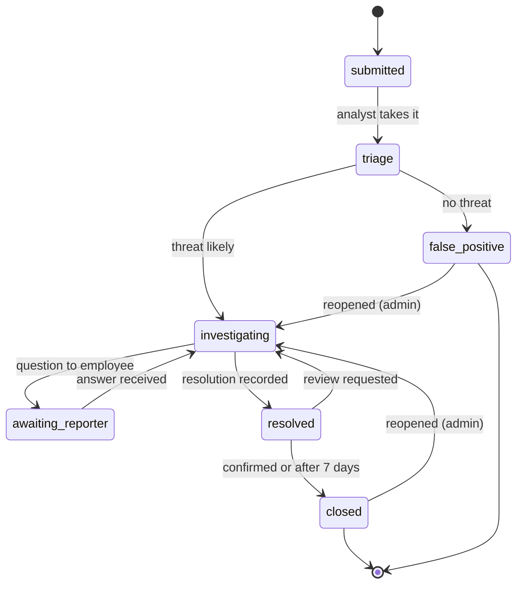

# CyberGuard — Domain Specification

Version: draft, 8 Nov 2026 · Author: Vitalina (domain expert) · [Slovenská verzia](domain-specification.sk.md)

## Purpose

This document describes the domain side of CyberGuard: incident fields, categories, severity, indicators, statuses, permissions, playbooks and demo scenarios. It covers the items in section 12 of `project-plan.md` that must be agreed before implementation.

Who needs what:

- **Architect (Nikita):** statuses and the permission matrix — for the database schema and API contracts.
- **AI expert (SaiLenT):** categories, severity rubric and indicators — inputs for the model (Choice, Score and Noul operations).
- **Go developer:** incident fields and the values of the `category`, `severity` and `status` enums.

## Incident fields

What is stored about each incident, who fills each field in and who may change it later. Comments are a separate entity (see below), not a field of the incident.

| Field | Meaning | Required | Filled in by | Who may change it |
| --- | --- | --- | --- | --- |
| `id` | Unique identifier (UUID) | yes | system | nobody |
| `reporter_id` | Who reported the incident | yes | system (from the session) | nobody |
| `title` | Short title | yes | employee | nobody after submission |
| `description` | Description of the situation | yes | employee | nobody after submission |
| `affected_system` | Affected system (free text) | no | employee | assigned analyst, admin |
| `status` | Incident status | yes (`submitted`) | system | analyst / admin, allowed transitions only |
| `category` | Category | no (`null`) | analyst | assigned analyst, admin |
| `severity` | Severity | no (`null`) | analyst | assigned analyst, admin |
| `assigned_analyst_id` | Analyst handling the incident | no | analyst (takes it) | admin may reassign |
| `resolution_note` | What was done and the outcome | when moving to `resolved` | analyst | assigned analyst, admin |
| `status_reason` | Reason for false positive, reopening or review request | for those transitions | whoever makes the transition | nobody |
| `archived_at`, `archive_reason` | Archiving (soft delete) | no | admin | nobody |
| `created_at`, `updated_at` | Creation and last update time | yes | system | nobody |

Rules:

- **The description cannot be edited after submission.** It records what the employee originally reported. Further information is added as comments.
- **Some fields become required only at a certain step.** For example, `resolution_note` may stay empty until the incident is resolved, but the transition to `resolved` is rejected without it.
- **Maximum lengths:** `title` 200 characters, `description` 10,000, `affected_system` 500. Required fields must contain non-whitespace text.
- **Comments** are a separate entity: incident, author, text, time and visibility — `public` or `internal`.

### What the reporter sees

The reporter is the person who submitted the incident, whatever their role. On their own incident they see:

| Information | Visible to the reporter |
| --- | --- |
| Confirmed `category` | yes — it helps them recognise the threat next time |
| Confirmed `severity` | no — it is an internal queue priority |
| Assigned analyst (username) | yes |
| `resolution_note` | yes, in full — the analyst writes it for the reporter; technical details go into internal comments |
| Public comments | yes, and they may reply |
| Internal comments, AI suggestions, brief | no |

Being able to read a field does not grant permission to change it.

## Incident categories

We propose 8 categories, phrased around what an employee can notice and describe themselves. Technical categories such as DDoS from the original proposal were dropped: an ordinary employee only sees "the site won't load", which is a service disruption.

| Code (`category`) | Name | What the employee reports | Example description |
| --- | --- | --- | --- |
| `phishing` | Phishing / social engineering | Suspicious email, message or call asking for a password, payment or a link click | "I got an email from 'IT support' asking me to confirm my password via a link" |
| `malware` | Malicious software | Strange computer behaviour, pop-ups, encrypted files, ransom demand | "After opening the attachment all files have the .locked extension" |
| `account_compromise` | Account compromise | A login they did not make; changed password; emails sent in their name | "Colleagues received emails from me that I never wrote" |
| `data_exposure` | Data leak / exposure | Data sent to the wrong recipient, published or taken out | "I sent a spreadsheet with customer data to the wrong address" |
| `lost_device` | Lost or stolen device | Lost laptop, phone or USB drive with work data | "I left my work laptop on the train" |
| `policy_violation` | Security policy violation | Unapproved software, sharing passwords, bypassing rules | "A colleague installed remote-access software without approval" |
| `service_disruption` | Service disruption | A system or service is unavailable and an attack is suspected | "The internal portal is down with a strange message on screen" |
| `other` | Other / unclear | Fits no category | — |

Rules:

- One incident has one main category. The analyst notes anything else in a comment.
- `ransomware` is a subcategory of `malware`, not a separate main category: it marks malware that encrypts files and demands a ransom. Such incidents are usually `critical`. How the subcategory is stored is an engineering decision.
- Incident descriptions may be written in English or Slovak. English is the main language for development, documentation and AI tuning.
- `other` is a legitimate model answer under low confidence, not an error.
- Basis: a simplified ENISA Reference Incident Classification Taxonomy and the VERIS categories.

## Severity

Four levels on an ordinal scale — the input for the Score operation. The level is set by the most serious criterion that applies.

| Level (`severity`) | Criteria | Example | Target first analyst response |
| --- | --- | --- | --- |
| `critical` | Active attack with wide impact; critical data encrypted or exfiltrated; key system stopped | Ransomware on several computers | Immediately |
| `high` | Credentials compromised; personal or confidential data exposed; several users affected | Employee entered a password on a phishing site | Same working day |
| `medium` | One user or system affected, risk exists but no confirmed damage | Suspicious attachment opened, antivirus reports nothing | Within 2 working days |
| `low` | Attempt without consequences or violation without damage | Phishing email received but not opened | In queue order |

Rules:

- A new incident has `severity = null` until someone assesses it.
- The model only suggests a level; the analyst makes the final decision.
- If the description mentions no signs of damage, the level is not lowered automatically: the employee may not have noticed the consequences.
- Response times are guidance for the demo and dashboard, not a binding SLA.

## Indicators (yes/no questions)

Eight narrow questions for the Noul operation. Each checks only what the description **explicitly states**, not what probably happened.

| Code | Question about the description | Why it matters to the analyst | Effect on severity |
| --- | --- | --- | --- |
| `clicked_link` | Does the employee say they clicked a link? | Possible malware download or data entry | ↑ to medium |
| `credentials_entered` | Does the employee say they entered a password or code? | Immediate password change, login review | ↑ to high |
| `attachment_opened` | Does the employee say they opened an attachment or ran a file? | Check the device for malware | ↑ to medium |
| `payment_made` | Is a payment or transfer mentioned? | Financial damage, contact the bank | ↑ to high |
| `data_sent_out` | Is data said to have left the company? | Possible notification duty (GDPR) | ↑ to high |
| `device_abnormal` | Is unusual device behaviour described? | Sign of malware | — |
| `multiple_affected` | Are other affected employees or systems mentioned? | Scope, possible escalation | ↑ one level |
| `ongoing` | Is the described activity still happening? | Urgency of containment | ↑ one level |

Rules:

- A "no" probability ≠ "it did not happen". It means "the description does not say".
- Indicators with high probability are highlighted on the incident card and are candidates for follow-up questions in the brief.
- Probability thresholds are set by the AI expert after evaluation on the demo data.

## Lifecycle and statuses

Seven statuses following the NIST/SANS model. They are separate from AI job states (`queued`, `running`, `completed`, `failed`).

Archiving (`archived_at`) is not a workflow status but a soft-delete marker: an admin can set it in any status, with a reason.

| Transition | Who | Condition / what is recorded |
| --- | --- | --- |
| submitted → triage | Analyst | Analyst took the incident; assignment recorded |
| triage → investigating | Analyst | Threat is likely; category and severity set |
| triage → false_positive | Analyst | No threat; reason required; employee is notified |
| investigating → awaiting_reporter | Analyst | A question was sent to the employee |
| awaiting_reporter → investigating | Reporter | Reporter answered with a public comment (automatic; internal notes do not count) |
| investigating → resolved | Analyst | Resolution and measures taken recorded |
| resolved → closed | Reporter / system | Reporter confirmed, or automatically after 7 days without a response |
| resolved → investigating | Reporter | Reporter requested a review, with a comment |
| closed / false_positive → investigating | Admin | Reopened with a reason |

## Permission matrix

The Employee ⊂ Analyst ⊂ Admin hierarchy from the plan, broken down by action. All checks run on the backend.

| Action | Employee | Analyst | Admin |
| --- | --- | --- | --- |
| Create an incident | ✓ | ✓ | ✓ |
| See own incidents | ✓ | ✓ | ✓ |
| See all company incidents | — | ✓ | ✓ |
| Add information / answer a question | own | ✓ | ✓ |
| Read and write public comments | own | ✓ | ✓ |
| Read and write internal comments | — | ✓ | ✓ |
| See AI suggestions and brief | — | ✓ | ✓ |
| Take an incident (assign to self) | — | ✓ | ✓ |
| Assign or reassign someone else | — | — | ✓ |
| Change category, severity, status | — | assigned to self | ✓ |
| Accept or correct an AI suggestion | — | assigned to self | ✓ |
| Close as resolved / false positive | — | assigned to self | ✓ |
| Confirm resolution or request review (own incident) | ✓ | ✓ | ✓ |
| Reopen a closed incident | — | — | ✓ |
| Archive (soft delete with reason) | — | — | ✓ |
| Manage users and roles | — | — | ✓ |
| See the audit log | — | — | ✓ |
| Run the demo import | — | — | ✓ |

Constraints:

- Employees do not see AI assessments: they are the analyst's working hypotheses, not conclusions for the reporter.
- Employees never see internal comments.
- An analyst may handle an incident they reported themselves.
- Confirming resolution and requesting review are rights of the reporter, based on ownership, not on role.
- Analysts who are not assigned to an incident can read it but not change it.

## Playbooks for the LLM brief

We propose one short playbook per category (except `other`), 5–8 steps, following containment → eradication → recovery. The LLM takes steps only from these and does not invent its own.

Example — `phishing`:

1. Ask the employee whether they clicked the link, entered data or opened an attachment.
2. If a password was entered — change it and end all active sessions of the account.
3. Check whether other employees received the same email.
4. Block the sender and the link's domain.
5. If an attachment was opened — check the device for malware (continue with the `malware` playbook).
6. Record indicators (sender address, domain) in an incident comment.
7. Tell the employee the outcome and remind them of the signs of phishing.

Sources for the remaining playbooks (freely available):

- NIST SP 800-61 — Computer Security Incident Handling Guide.
- CISA — Federal Government Cybersecurity Incident & Vulnerability Response Playbooks.
- The SANS PICERL model (Preparation, Identification, Containment, Eradication, Recovery, Lessons learned).

The remaining 6 playbooks will be added once the categories are agreed.

## Demo scenarios

Ten synthetic incidents cover all categories and levels, including two hard cases for the model. Texts are in English (the main model input), with no real passwords or data. A few Slovak descriptions will be added to the demo set, because the system also accepts Slovak.

| # | Employee description (short) | Expected category | Expected severity | What it shows |
| --- | --- | --- | --- | --- |
| 1 | Got an email from "IT support" asking to confirm my password via link, I didn't click | phishing | low | Basic scenario |
| 2 | Clicked the link in a bank email and entered my login, now unsure | phishing | high | `credentials_entered` indicator |
| 3 | All my files now end with .locked and there's a ransom note | malware | critical | Urgent escalation |
| 4 | Colleagues received emails from me I never sent | account_compromise | high | Login review |
| 5 | Sent a spreadsheet with customer data to the wrong address | data_exposure | high | Leak without an attack |
| 6 | Left my work laptop on the train | lost_device | medium | Incident without an attacker |
| 7 | Coworker installed remote-access software without approval | policy_violation | medium | Policy violation |
| 8 | Internal portal is down with a strange message on screen | service_disruption | medium | Availability |
| 9 | My computer is slow and fan is loud since this morning | other / malware | low | Low confidence → manual assessment |
| 10 | Supplier asked to change bank details for next invoice payment | phishing | high | Fraud without a link (BEC) |

Presentation scenario: no. 2 goes through the full cycle — report, AI suggestion, question to the employee, analyst corrects severity, resolution, confirmation.

## Agreed decisions

| Question | Decision | Who |
| --- | --- | --- |
| After how many days does `resolved` automatically become `closed`? | After 7 days without an employee response | Nikita |
| May an analyst handle an incident they reported? | Yes | Nikita |
| Format of project documents | Plain text (.md, .org) so they are readable on GitHub | Nikita |
| Documentation language | English by default; a Slovak version may be added alongside | Nikita |
| Maximum input lengths | `title` 200, `description` 10,000, `affected_system` 500 | Vitalina, Daniil |
| What the reporter sees | Category, assigned analyst, resolution note and public comments; not severity, internal comments or AI output | Vitalina |
| Reporter actions | Confirm / request review are ownership rights, for any role | Vitalina, Daniil |
| Who changes category, severity, `affected_system`, `resolution_note`, AI suggestions | Assigned analyst and admin only | Vitalina, Daniil |
| Comment visibility | Two types: `public` and `internal` | Vitalina, Daniil |
| `ransomware` | A subcategory of `malware`, not a main category | SaiLenT |
| Number of categories | All 8 stay; `other` only for incidents that fit no category | SaiLenT |
| Description language | English and Slovak accepted; English is the main language | SaiLenT |
