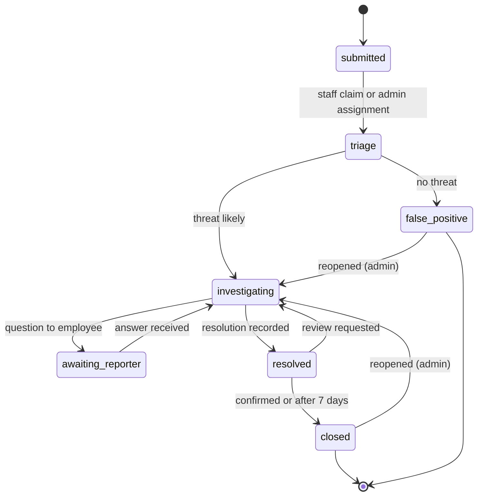

# CyberGuard — Domain Specification

Author: Vitalina (domain expert) · [Slovenská verzia](domain-specification.sk.md)

## Purpose

This document describes CyberGuard's incident fields, taxonomy, severity rubric,
lifecycle, permissions, playbooks, and demo scenarios. See the
[architecture overview](../README.md#architecture) for component contracts and the
[temporary backlog](backlog.md) for unfinished work.

## Incident fields

What is stored about each incident, who fills each field in and who may change it later. Comments are a separate entity (see below), not a field of the incident.

| Field | Meaning | Required | Filled in by | Who may change it |
| --- | --- | --- | --- | --- |
| `id` | Unique identifier (UUID) | yes | system | nobody |
| `reporter_id` | Who reported the incident | yes | system (from the session) | nobody |
| `title` | Short title | yes | reporter | nobody after submission |
| `description` | Description of the situation | yes | reporter | nobody after submission |
| `affected_system` | Affected system (free text) | no | reporter | assigned analyst, admin |
| `status` | Incident status | yes (`submitted`) | system | allowed actors for each transition |
| `category` | Confirmed category | no (`null`) | assigned analyst or admin | assigned analyst, admin |
| `severity` | Confirmed severity | no (`null`) | assigned analyst or admin | assigned analyst, admin |
| `assigned_analyst_id` | Staff member handling the incident | no | staff member who claims it, or admin assigning an active analyst | admin may reassign in eligible states |
| `resolution_note` | What was done and the outcome | when moving to `resolved` | assigned analyst or admin | assigned analyst, admin |
| `archived_at`, `archive_reason` | Archive marker and reason (soft delete) | when archiving | admin | nobody |
| `created_at`, `updated_at` | Creation and last update time | yes | system | nobody |

Rules:

- **The title and description cannot be edited after submission.** Further information is added as comments.
- **Some fields become required only at a certain step.** For example, `resolution_note` may stay empty until the incident is resolved, but the transition to `resolved` is rejected without it.
- **Maximum lengths:** `title` 200 characters, `description` 10,000, `affected_system` 500. Required fields must contain non-whitespace text.
- **Comments** are a separate entity: incident, author, text, time and visibility — `public` or `internal`.
- **Transition reasons** are recorded in the incident action history, not mutable incident fields. The archive reason is stored with the archive marker and also recorded in the action history.

### What the reporter sees

Ordinary employee reporters see the restricted view below. Analysts and admins
retain their normal professional visibility (including severity, internal comments
and AI suggestions), including on incidents they submitted themselves. Authorship
does not grant an unassigned analyst permission to change confirmed fields.

| Information | Visible to the reporter |
| --- | --- |
| Current status and in-app notifications | yes |
| Confirmed `category` | yes — it helps them recognise the threat next time |
| Confirmed `severity` | no — it is an internal queue priority |
| Assigned analyst (username) | yes |
| `resolution_note` | yes, in full — the analyst writes it for the reporter; technical details go into internal comments |
| Public comments | yes, and they may reply |
| Internal comments, staff action history, AI suggestions, brief | no |

Being able to read a field does not grant permission to change it.

## Incident categories

The eight categories are phrased around what an employee can notice and describe.
For example, an employee can report "the site won't load" as a service disruption
without having to diagnose its technical cause.

| Code (`category`) | Name | What the employee reports | Example description |
| --- | --- | --- | --- |
| `phishing` | Phishing / social engineering | Suspicious email, message or call asking for a password, payment or a link click | "I got an email from 'IT support' asking me to confirm my password via a link" |
| `malware` | Malicious software | Strange computer behaviour, pop-ups, encrypted files, ransom demand | "After opening the attachment all files have the .locked extension" |
| `account_compromise` | Account compromise | A login they did not make; changed password; emails sent in their name | "Colleagues received emails from me that I never wrote" |
| `data_exposure` | Data leak / exposure | Data sent to the wrong recipient, published or taken out | "I sent a spreadsheet with customer data to the wrong address" |
| `lost_device` | Lost or stolen device | Lost laptop, phone or USB drive with work data | "I left my work laptop on the train" |
| `policy_violation` | Security policy violation | Unapproved software, sharing passwords, bypassing rules | "A colleague installed remote-access software without approval" |
| `service_disruption` | Service disruption | A system or service is unavailable and an attack is suspected | "The internal portal is down with a strange message on screen" |
| `other` | Other / unclear | Fits no category | — |

Rules:

- One incident has one main category. The analyst notes anything else in a comment.
- Ransomware is a type of `malware`, not a separately stored category or subtype. The report or comments can record that detail. Such incidents are often `critical`, depending on impact.
- Incident descriptions may be written in English or Slovak. English is the main language for development, documentation and AI tuning.
- `other` is a valid confirmed category. If AI's best answer is `other` or below its category threshold, the UI shows no suggested category.
- Basis: a simplified ENISA Reference Incident Classification Taxonomy and the VERIS categories.

## Severity

Four levels on an ordinal scale. The confirmed level is set by the most serious criterion that applies.

| Level (`severity`) | Criteria | Example | Target first analyst response |
| --- | --- | --- | --- |
| `critical` | Active attack with wide impact; critical data encrypted or exfiltrated; key system stopped | Ransomware on several computers | Immediately |
| `high` | Credentials compromised; personal or confidential data exposed; several users affected | Employee entered a password on a phishing site | Same working day |
| `medium` | One user or system affected, risk exists but no confirmed damage | Suspicious attachment opened, antivirus reports nothing | Within 2 working days |
| `low` | Attempt without consequences or violation without damage | Phishing email received but not opened | In queue order |

Rules:

- A new incident has `severity = null` until someone assesses it.
- The model reports a separate 0–3 potential impact score. It does not set severity.
  Assigned analysts or admins confirm severity separately from category-only AI feedback.
- If the description mentions no signs of damage, the level is not lowered automatically: the employee may not have noticed the consequences.
- Response times are domain guidance, not a binding or enforced SLA.

## Indicators (yes/no questions)

This eight-question **domain rubric** checks what the description **explicitly
states**, not what probably happened. It is not the current AI output schema.
Today the [AI service](ai-backend.md#models-and-output) evaluates four signals:
suspicious link clicked, credentials entered, files encrypted, and unauthorized
access reported. Staff can view their probabilities in the assessment details.
Expanded coverage and highlighting are tracked in the [temporary backlog](backlog.md).

| Code | Question about the description | Why it matters to the analyst | Severity guidance for human review |
| --- | --- | --- | --- |
| `clicked_link` | Does the employee say they clicked a link? | Possible malware download or data entry | ↑ to medium |
| `credentials_entered` | Does the employee say they entered a password or code? | Immediate password change, login review | ↑ to high |
| `attachment_opened` | Does the employee say they opened an attachment or ran a file? | Check the device for malware | ↑ to medium |
| `payment_made` | Is a payment or transfer mentioned? | Financial damage, contact the bank | ↑ to high |
| `data_sent_out` | Is data said to have left the company? | Possible notification duty (GDPR) | ↑ to high |
| `device_abnormal` | Is unusual device behaviour described? | Sign of malware | — |
| `multiple_affected` | Are other affected employees or systems mentioned? | Scope, possible escalation | ↑ one level |
| `ongoing` | Is the described activity still happening? | Urgency of containment | ↑ one level |

Rules:

- A "no" probability ≠ "it did not happen". It means "the description does not say".
- The severity guidance is for analysts. An indicator never changes incident severity automatically.

## Lifecycle and statuses

Seven statuses following the NIST/SANS model. They are separate from AI job states (`queued`, `running`, `completed`, `failed`).

Archiving (`archived_at`) is not a workflow status but a soft-delete marker: an admin can set it in any status, with a reason.

| Transition | Who | Condition / what is recorded |
| --- | --- | --- |
| submitted → triage | Analyst / admin | Staff member claims it, or an admin assigns an active analyst; assignment is recorded |
| triage → investigating | Assigned analyst / admin | Threat is likely; category and severity set |
| triage → false_positive | Assigned analyst / admin | No threat; reason required; reporter is notified |
| investigating → awaiting_reporter | Assigned analyst / admin | The requester posted a public question during this investigation cycle; the reporter has not answered it publicly |
| awaiting_reporter → investigating | Reporter | Reporter answered with a public comment (automatic; internal notes do not count) |
| investigating → resolved | Assigned analyst / admin | Resolution and measures taken recorded |
| resolved → closed | Reporter / system | Reporter confirmed, or automatically after 7 days without a response |
| resolved → investigating | Reporter | A public reply or a formal review request with a reason reopens the investigation, clears the closure timer, records the transition and notifies the assigned analyst |
| closed / false_positive → investigating | Admin | Reopened with a reason |

## Permission matrix

The backend checks role, assignment, and reporter ownership separately.

| Action | Employee | Analyst | Admin |
| --- | --- | --- | --- |
| Create an incident | ✓ | ✓ | ✓ |
| See own incidents | ✓ | ✓ | ✓ |
| See all company incidents | — | ✓ | ✓ |
| Read public comments | own | ✓ | ✓ |
| Write public comments / reply as reporter | own | own report or assigned to self | ✓ |
| Read and write internal comments | — | ✓ (including unassigned) | ✓ |
| See AI suggestions and brief | — | ✓ | ✓ |
| Claim an unassigned `submitted` incident | — | ✓ | ✓ |
| Assign or reassign to an active analyst | — | — | ✓ |
| Change confirmed fields / make staff transitions | — | assigned to self | ✓ |
| Record a category review or reject an AI assessment | — | assigned to self | ✓ |
| Mark as resolved / false positive | — | assigned to self | ✓ |
| Confirm resolution or request review (own incident) | ✓ | ✓ | ✓ |
| Reopen a closed incident | — | — | ✓ |
| Archive (soft delete with reason) | — | — | ✓ |
| Manage users and roles | — | — | ✓ |
| Read incident action history | — | non-archived incidents | includes archived incidents by ID |
| Read the account administration audit | — | — | ✓ |

Constraints:

- Employees do not see AI assessments: they are the analyst's working hypotheses, not conclusions for the reporter.
- Employees never see internal comments.
- An analyst may handle an incident they reported themselves.
- Confirming resolution and requesting review are rights of the reporter, based on ownership, not on role.
- Unassigned analysts can read accessible incidents and add internal notes. They can
  also post publicly as the reporter on their own reports; they do not gain
  permission to change confirmed fields.
- Reassignment is unavailable in `resolved`, `closed`, and `false_positive`.
  Confirmed-field edits and new AI reviews are unavailable in `closed` and
  `false_positive`; reopening follows the lifecycle rules above.

### Account registration and ownership

- When self-registration is enabled, a new account is active immediately and has
  the `employee` role. Users do not choose their role. Usernames are unique after
  normalization; a conflict reveals only that the name is unavailable.
- Administrators assign `analyst` and `admin` to existing accounts. They can block
  ordinary accounts after registration.
- One active admin is the application owner. Other admins cannot block or demote
  the owner or reset their password. Only the current owner can transfer ownership
  to another active admin, after confirming their own password. The former owner
  retains the `admin` role without owner protection.
- The deployment operator initializes the first owner separately from registration.
  For a demo, participants can register and an admin assigns the needed roles.

## Playbooks for the LLM brief

There is one playbook per category except `other`. The worker supplies up to four
steps from the matching playbook; the LLM does not generate the steps. The full
playbook remains a reference for the analyst.

Example — `phishing`:

1. Ask the employee whether they clicked the link, entered data or opened an attachment.
2. If a password was entered — change it and end all active sessions of the account.
3. Check whether other employees received the same email.
4. Block the sender and the link's domain.
5. If an attachment was opened — check the device for malware (continue with the `malware` playbook).
6. Record indicators (sender address, domain) in an incident comment.
7. Tell the employee the outcome and remind them of the signs of phishing.

Sources for the remaining playbooks (freely available):

- NIST SP 800-61 — Computer Security Incident Handling Guide.
- CISA — Federal Government Cybersecurity Incident & Vulnerability Response Playbooks.
- The SANS PICERL model (Preparation, Identification, Containment, Eradication, Recovery, Lessons learned).

All seven playbooks are in [playbooks.md](playbooks.md).

## Demo scenarios

The examples below are synthetic and contain no real passwords or company data.

| # | Employee description (short) | Expected category | Expected severity | What it shows |
| --- | --- | --- | --- | --- |
| 1 | Got an email from "IT support" asking to confirm my password via link, I didn't click | phishing | low | Basic scenario |
| 2 | Clicked the link in a bank email and entered my login, now unsure | phishing | high | `credentials_entered` indicator |
| 3 | All my files now end with .locked and there's a ransom note | malware | critical | Urgent escalation |
| 4 | Colleagues received emails from me I never sent | account_compromise | high | Login review |
| 5 | Sent a spreadsheet with customer data to the wrong address | data_exposure | high | Leak without an attack |
| 6 | Left my work laptop on the train | lost_device | medium | Incident without an attacker |
| 7 | Coworker installed remote-access software without approval | policy_violation | medium | Policy violation |
| 8 | Internal portal is down with a strange message on screen | service_disruption | medium | Availability |
| 9 | My computer is slow and fan is loud since this morning | other / malware | low | Low confidence → manual assessment |
| 10 | Supplier asked to change bank details for next invoice payment | phishing | high | Fraud without a link (BEC) |

The full set contains 80 labelled descriptions (61 English, 19 Slovak) in
[demo-incidents.csv](demo-incidents.csv). These are reference labels, not measured
model results. The local demo script can submit scenario no. 2 only; account seeding
does not import incidents.

Presentation scenario: no. 2 goes through the full cycle — report, AI suggestion, question to the employee, analyst corrects severity, resolution, confirmation.

## Agreed decisions

| Question | Decision | Who |
| --- | --- | --- |
| After how many days does `resolved` automatically become `closed`? | After 7 days without an employee response | Nikita |
| May an analyst handle an incident they reported? | Yes | Nikita |
| Format of project documents | Plain text (.md, .org) so they are readable on GitHub | Nikita |
| Documentation language | English by default; this domain specification is maintained in both languages | Nikita |
| Maximum input lengths | `title` 200, `description` 10,000, `affected_system` 500 | Vitalina, Daniil |
| What an employee reporter sees | Current status, category, assigned analyst, resolution note, public comments and notifications; not professional fields or AI output | Vitalina |
| Reporter actions | Confirm / request review are ownership rights, for any role | Vitalina, Daniil |
| Who changes category, severity, `affected_system`, `resolution_note`, or records AI feedback | Assigned analyst and admin only; the stored AI assessment is not edited | Vitalina, Daniil |
| Comment visibility | Two types: `public` and `internal` | Vitalina, Daniil |
| Ransomware | Classified under `malware`; not stored separately | SaiLenT |
| Number of categories | All 8 stay; `other` only for incidents that fit no category | SaiLenT |
| Description language | English and Slovak accepted; English is the main language | SaiLenT |
