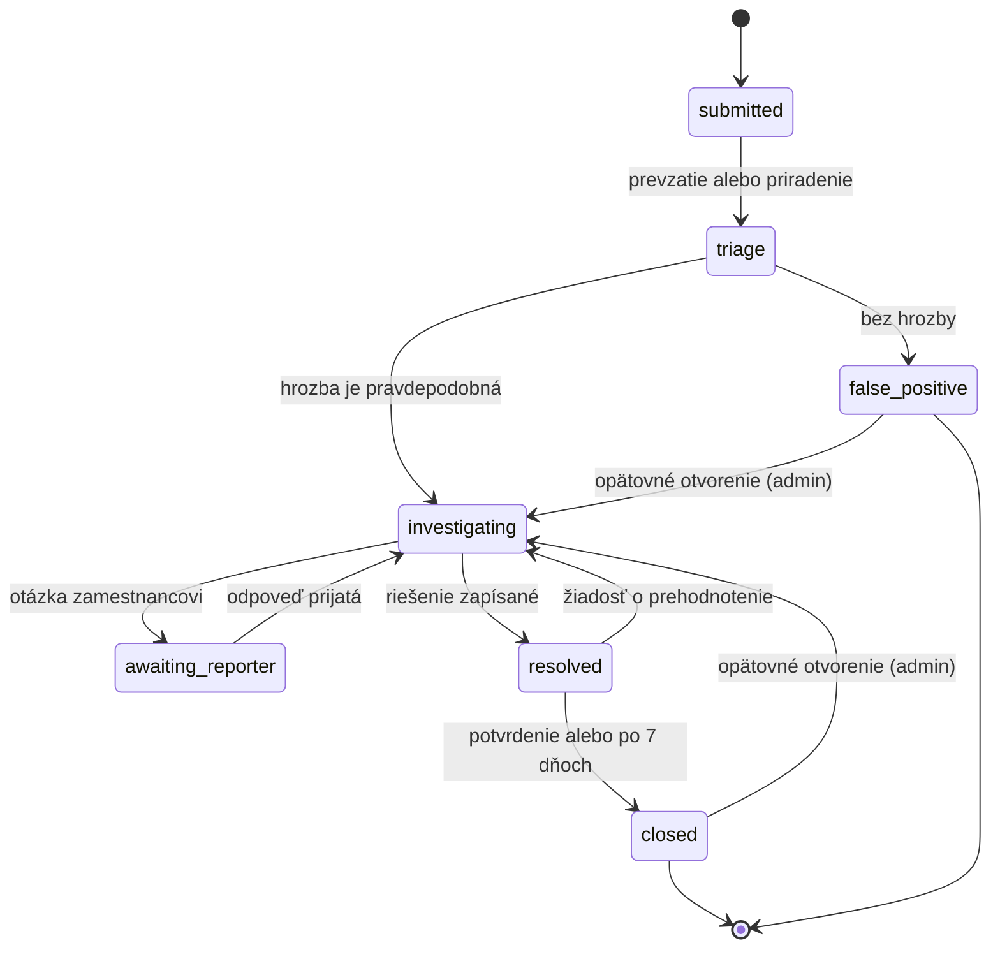

# CyberGuard — doménová špecifikácia

Autor: Vitalina (doménová expertka) · [English version](domain-specification.md)

## Účel

Tento dokument popisuje polia incidentu, kategórie, závažnosť, indikátory, životný
cyklus, prístupové práva, playbooky a demo scenáre systému CyberGuard. Rozhrania
komponentov opisuje [prehľad architektúry](../README.md#architecture); nedokončené úlohy sú v
[dočasnom zozname úloh](backlog.md).

## Polia incidentu

Čo sa o každom incidente ukladá, kto pole vypĺňa a kto ho môže neskôr meniť. Komentáre sú samostatná entita (pozri nižšie), nie pole incidentu.

| Pole | Význam | Povinné | Vypĺňa | Kto môže meniť |
| --- | --- | --- | --- | --- |
| `id` | Jedinečný identifikátor (UUID) | áno | systém | nikto |
| `reporter_id` | Kto incident nahlásil | áno | systém (zo session) | nikto |
| `title` | Krátky názov | áno | nahlasovateľ | nikto po odoslaní |
| `description` | Popis situácie | áno | nahlasovateľ | nikto po odoslaní |
| `affected_system` | Zasiahnutý systém (voľný text) | nie | nahlasovateľ | priradený analytik, admin |
| `status` | Stav incidentu | áno (`submitted`) | systém | podľa pravidiel jednotlivých prechodov |
| `category` | Potvrdená kategória | nie (`null`) | priradený analytik alebo admin | priradený analytik, admin |
| `severity` | Potvrdená závažnosť | nie (`null`) | priradený analytik alebo admin | priradený analytik, admin |
| `assigned_analyst_id` | Kto incident rieši | nie | analytik alebo admin pri prevzatí, prípadne admin priradí aktívneho analytika | admin môže preradiť v povolených stavoch |
| `resolution_note` | Čo sa urobilo a aký je výsledok | pri prechode do `resolved` | priradený analytik alebo admin | priradený analytik, admin |
| `archived_at`, `archive_reason` | Príznak a dôvod archivácie (soft delete) | pri archivácii | admin | nikto |
| `created_at`, `updated_at` | Čas vytvorenia a poslednej zmeny | áno | systém | nikto |

Pravidlá:

- **Názov ani popis sa po odoslaní nedajú upravovať.** Ďalšie informácie sa pridávajú ako komentáre.
- **Niektoré polia sú povinné až v určitom kroku.** Napríklad `resolution_note` môže zostať prázdne, kým incident nie je vyriešený, ale bez neho prechod do `resolved` nie je možný.
- **Maximálne dĺžky:** `title` 200 znakov, `description` 10 000, `affected_system` 500. Povinné polia musia obsahovať text, nielen medzery.
- **Komentáre** sú samostatná entita: incident, autor, text, čas a viditeľnosť — `public` alebo `internal`.
- **Dôvody zmeny stavu** patria do histórie akcií, nie do upraviteľných polí
  incidentu. Dôvod archivácie sa ukladá s príznakom archivácie aj do histórie akcií.

### Čo vidí nahlasovateľ

Nahlasovateľ je ten, kto incident odoslal, bez ohľadu na jeho rolu. Nasledujúca
tabuľka platí pre bežného zamestnanca. Analytici a administrátori vidia závažnosť,
interné komentáre a AI výstupy aj pri vlastných hláseniach. Samotné autorstvo
nedáva nepriradenému analytikovi právo meniť potvrdené polia.

| Informácia | Viditeľná pre nahlasovateľa |
| --- | --- |
| Aktuálny stav a notifikácie v aplikácii | áno |
| Potvrdená `category` | áno — pomôže mu hrozbu nabudúce rozpoznať |
| Potvrdená `severity` | nie — je to interná priorita fronty |
| Priradený analytik (používateľské meno) | áno |
| `resolution_note` | áno, celé — analytik ho píše pre nahlasovateľa; technické detaily patria do interných komentárov |
| Verejné komentáre | áno, a môže na ne odpovedať |
| Interné komentáre, história akcií, AI návrhy, bríf | nie |

Možnosť pole čítať neznamená právo ho meniť.

## Kategórie incidentov

Osem kategórií vychádza z toho, čo zamestnanec vie sám spozorovať a opísať.
Napríklad „stránka sa nenačíta“ možno nahlásiť ako výpadok dostupnosti bez
určenia technickej príčiny.

| Kód (`category`) | Názov | Čo hlási zamestnanec | Príklad popisu |
| --- | --- | --- | --- |
| `phishing` | Phishing / sociálne inžinierstvo | Podozrivý e-mail, správa alebo hovor so žiadosťou o heslo, platbu či kliknutie na odkaz | „Prišiel mi e-mail od ‚IT oddelenia', aby som urýchlene potvrdila heslo cez odkaz" |
| `malware` | Škodlivý softvér | Zvláštne správanie počítača, vyskakovacie okná, zašifrované súbory, žiadosť o výkupné | „Po otvorení prílohy majú všetky súbory príponu .locked" |
| `account_compromise` | Kompromitácia účtu | Prihlásenie, ktoré nevykonal; zmenené heslo; e-maily odoslané v jeho mene | „Kolegovia dostali odo mňa e-maily, ktoré som nepísala" |
| `data_exposure` | Únik / vyzradenie údajov | Údaje odoslané nesprávnemu príjemcovi, zverejnené alebo vynesené | „Poslala som tabuľku s údajmi klientov nesprávnemu adresátovi" |
| `lost_device` | Strata alebo krádež zariadenia | Stratený notebook, telefón, USB kľúč s pracovnými údajmi | „Nechala som pracovný notebook vo vlaku" |
| `policy_violation` | Porušenie bezpečnostných pravidiel | Nepovolený softvér, zdieľanie hesiel, obchádzanie pravidiel | „Kolega si nainštaloval cudzí program na vzdialený prístup" |
| `service_disruption` | Výpadok dostupnosti | Nedostupný systém alebo služba s podozrením na útok | „Interný portál je nedostupný, na obrazovke je zvláštna správa" |
| `other` | Iné / nejasné | Nezodpovedá žiadnej kategórii | — |

Pravidlá:

- Jeden incident má jednu hlavnú kategóriu. Ďalšie súvislosti analytik uvedie v komentári.
- Ransomware patrí pod `malware` a neukladá sa ako samostatná kategória ani
  podkategória. Možno ho uviesť v hlásení alebo komentári. Také incidenty sú
  často `critical`, podľa dopadu.
- Popisy incidentov môžu byť v angličtine alebo v slovenčine. Angličtina je hlavný jazyk pre vývoj, dokumentáciu a ladenie AI.
- `other` je platná potvrdená kategória. Ak je najlepšou odpoveďou AI `other`
  alebo je pravdepodobnosť pod prahom, rozhranie nezobrazí návrh kategórie.
- Základ: zjednodušená ENISA Reference Incident Classification Taxonomy a kategórie VERIS.

## Závažnosť (severity)

Štyri úrovne na ordinálnej škále. Potvrdená úroveň sa určuje podľa
najzávažnejšieho splneného kritéria.

| Úroveň (`severity`) | Kritériá | Príklad | Cieľová prvá reakcia analytika |
| --- | --- | --- | --- |
| `critical` | Aktívny útok s plošným dopadom; zašifrované alebo vynesené kritické údaje; zastavený kľúčový systém | Ransomware na viacerých počítačoch | Okamžite |
| `high` | Kompromitované prihlasovacie údaje; vyzradené osobné alebo dôverné údaje; zasiahnutých viac používateľov | Zamestnanec zadal heslo na phishingovej stránke | V ten istý pracovný deň |
| `medium` | Zasiahnutý jeden používateľ alebo systém, existuje riziko, ale škoda nie je potvrdená | Otvorená podozrivá príloha, antivírus nič nehlási | Do 2 pracovných dní |
| `low` | Pokus bez následkov alebo porušenie bez škody | Phishingový e-mail prijatý, ale neotvorený | Podľa poradia |

Pravidlá:

- Nový incident má `severity = null`, kým ho niekto neohodnotí.
- Model uvádza samostatné skóre možného dopadu od 0 do 3. Závažnosť nenastavuje.
  Priradený analytik alebo admin ju potvrdzuje nezávisle od AI hodnotenia kategórie.
- Ak popis neuvádza znaky škody, úroveň sa automaticky neznižuje: zamestnanec si následky nemusel všimnúť.
- Čas reakcie je orientačný; nejde o záväzné ani systémom vynucované SLA.

## Indikátory (otázky áno/nie)

Týchto osem otázok tvorí **doménovú metodiku**. Každá overuje len to, čo je
v popise **výslovne uvedené**, nie to, čo sa pravdepodobne stalo. Nejde o aktuálnu
schému výstupu AI. [Služba AI](ai-backend.md#models-and-output) dnes vyhodnocuje
štyri signály: kliknutie na podozrivý odkaz, zadanie prihlasovacích údajov,
zašifrovanie súborov a nahlásený neoprávnený prístup. Analytici a administrátori
vidia pravdepodobnosti v detaile posúdenia. Rozšírenie a zvýraznenie signálov je v
[dočasnom zozname úloh](backlog.md).

| Kód | Otázka k popisu | Prečo je to dôležité pre analytika | Odporúčanie pre posúdenie závažnosti |
| --- | --- | --- | --- |
| `clicked_link` | Zamestnanec uvádza, že klikol na odkaz? | Možné stiahnutie malvéru alebo zadanie údajov | ↑ na medium |
| `credentials_entered` | Zamestnanec uvádza, že zadal heslo alebo kód? | Okamžitá zmena hesla, kontrola prihlásení | ↑ na high |
| `attachment_opened` | Zamestnanec uvádza, že otvoril prílohu alebo spustil súbor? | Kontrola zariadenia na malvér | ↑ na medium |
| `payment_made` | Uvádza sa vykonaná platba alebo prevod? | Finančná škoda, kontakt s bankou | ↑ na high |
| `data_sent_out` | Uvádza sa, že údaje opustili firmu? | Možná ohlasovacia povinnosť (GDPR) | ↑ na high |
| `device_abnormal` | Je opísané nezvyčajné správanie zariadenia? | Znak malvéru | — |
| `multiple_affected` | Spomínajú sa ďalší zasiahnutí zamestnanci alebo systémy? | Rozsah, možná eskalácia | ↑ o jednu úroveň |
| `ongoing` | Opísaná aktivita stále prebieha? | Naliehavosť obmedzenia škody | ↑ o jednu úroveň |

Pravidlá:

- Pravdepodobnosť „nie" ≠ „nestalo sa". Znamená to „v popise sa to neuvádza".
- Odporúčania sú určené analytikom. Indikátory nikdy automaticky nemenia závažnosť incidentu.

### Aktuálne signály AI a metodika (návrh)

Model dnes vyhodnocuje štyri signály. Navrhované priradenie k metodike:

| Aktuálny signál AI | Indikátor metodiky | Návrh |
| --- | --- | --- |
| Kliknutie na podozrivý odkaz | `clicked_link` | Rovnaký význam; ponechať |
| Zadanie prihlasovacích údajov | `credentials_entered` | Rovnaký význam; ponechať |
| Zašifrovanie súborov | — | Doplniť do metodiky ako `files_encrypted`: silný znak ransomvéru; odporúčanie ↑ na critical |
| Nahlásený neoprávnený prístup | — | Doplniť do metodiky ako `unauthorized_access`; odporúčanie ↑ na high |

Indikátory metodiky, ktoré model zatiaľ nepokrýva, v navrhovanom poradí
implementácie: `payment_made` a `data_sent_out` (finančné a GDPR dôsledky),
potom `attachment_opened`, `multiple_affected`, `ongoing` a `device_abnormal`.

Skóre potenciálneho dopadu 0–3 sa analytikom zobrazuje ako pomôcka pri poli
závažnosti: 0 → low, 1 → medium, 2 → high, 3 → critical. Nikdy sa vopred
nevyberie ani neuloží ako potvrdená závažnosť.

Ak AI nenavrhne kategóriu, používateľské rozhranie vysvetlí prečo (navrhované znenie):

- Zvíťazila `other`: „Kategória nie je navrhnutá: popis jasne nezodpovedá žiadnej kategórii. Vyberte ju ručne.“
- Pod prahom: „Kategória nie je navrhnutá: model si nie je dostatočne istý. Najvyššie skóre: ‹kategória› ‹skóre›. Vyberte kategóriu.“

## Životný cyklus a stavy

Sedem stavov podľa modelu NIST/SANS. Sú oddelené od stavov AI úlohy (`queued`, `running`, `completed`, `failed`).

Archivácia (`archived_at`) nie je stav v toku, ale príznak soft delete: administrátor ju môže nastaviť v akomkoľvek stave s uvedením dôvodu.

| Prechod | Kto | Podmienka / čo sa zaznamená |
| --- | --- | --- |
| submitted → triage | Analytik / admin | Analytik alebo admin incident prevezme, prípadne admin priradí aktívneho analytika; priradenie sa zaznamená |
| triage → investigating | Priradený analytik / admin | Hrozba je pravdepodobná; kategória a závažnosť sú určené |
| triage → false_positive | Priradený analytik / admin | Hrozba neexistuje; dôvod je povinný; nahlasovateľ dostane notifikáciu |
| investigating → awaiting_reporter | Priradený analytik / administrátor | Osoba žiadajúca o odpoveď položila v aktuálnom cykle vyšetrovania verejnú otázku, na ktorú nahlasovateľ zatiaľ verejne neodpovedal |
| awaiting_reporter → investigating | Nahlasovateľ | Nahlasovateľ odpovedal verejným komentárom (automaticky; interné poznámky sa nepočítajú) |
| investigating → resolved | Priradený analytik / admin | Zaznamenané riešenie a prijaté opatrenia |
| resolved → closed | Nahlasovateľ / systém | Nahlasovateľ potvrdil, alebo automaticky po 7 dňoch bez odpovede |
| resolved → investigating | Nahlasovateľ | Verejná odpoveď alebo formálna žiadosť o prehodnotenie s odôvodnením obnoví vyšetrovanie. Lehota na uzatvorenie sa zruší, zmena stavu sa zaznamená a priradený analytik dostane notifikáciu |
| closed / false_positive → investigating | Admin | Opätovné otvorenie s dôvodom |

## Matica práv

Backend kontroluje rolu, priradenie a vlastníctvo hlásenia samostatne.

| Akcia | Employee | Analyst | Admin |
| --- | --- | --- | --- |
| Vytvoriť incident | ✓ | ✓ | ✓ |
| Vidieť vlastné incidenty | ✓ | ✓ | ✓ |
| Vidieť všetky incidenty firmy | — | ✓ | ✓ |
| Čítať verejné komentáre | vlastné | ✓ | ✓ |
| Písať verejné komentáre / odpovedať ako nahlasovateľ | vlastné | vlastné alebo priradené sebe | ✓ |
| Čítať a písať interné komentáre | — | ✓ (aj nepriradené) | ✓ |
| Vidieť AI návrhy a bríf | — | ✓ | ✓ |
| Prevziať nepriradený incident v stave `submitted` | — | ✓ | ✓ |
| Priradiť alebo preradiť k aktívnemu analytikovi | — | — | ✓ |
| Meniť potvrdené polia / vykonať prechod podľa roly | — | priradené sebe | ✓ |
| Zaznamenať posúdenie kategórie alebo zamietnuť AI posúdenie | — | priradené sebe | ✓ |
| Označiť ako vyriešený / false positive | — | priradené sebe | ✓ |
| Potvrdiť riešenie alebo požiadať o prehodnotenie (vlastný incident) | ✓ | ✓ | ✓ |
| Opätovne otvoriť uzavretý incident | — | — | ✓ |
| Archivovať (soft delete s dôvodom) | — | — | ✓ |
| Spravovať používateľov a roly | — | — | ✓ |
| Čítať históriu akcií incidentu | — | nearchivované incidenty | aj archivované podľa ID |
| Čítať audit správy účtov | — | — | ✓ |

Obmedzenia:

- Zamestnanec nevidí AI odhady: sú to pracovné hypotézy analytika, nie závery pre nahlasovateľa.
- Interné komentáre zamestnanec nikdy nevidí.
- Analytik môže riešiť aj incident, ktorý sám nahlásil.
- Potvrdenie riešenia a žiadosť o prehodnotenie sú práva nahlasovateľa podľa vlastníctva incidentu, nie podľa roly.
- Nepriradení analytici môžu čítať prístupné incidenty a pridať interné poznámky.
  Pri vlastnom hlásení môžu tiež verejne odpovedať ako nahlasovatelia. Tým
  nezískavajú právo meniť potvrdené polia.
- Preradenie nie je možné v stavoch `resolved`, `closed` a `false_positive`.
  V stavoch `closed` a `false_positive` nemožno meniť potvrdené polia ani
  pridať nové AI hodnotenie; opätovné otvorenie sa riadi životným cyklom.

### Registrácia účtov a vlastníctvo aplikácie

- Ak je samoregistrácia povolená, nový účet je ihneď aktívny a má rolu `employee`.
  Používateľ si rolu nevyberá. Používateľské meno musí byť po normalizácii
  jedinečné; pri konflikte sa oznámi len to, že meno nie je dostupné.
- Roly `analyst` a `admin` priraďuje administrátor existujúcim účtom. Účet možno
  po registrácii zablokovať.
- Vlastníkom aplikácie je jeden aktívny administrátor. Ostatní administrátori mu
  nemôžu zmeniť rolu, zablokovať účet ani obnoviť heslo. Vlastníctvo môže preniesť
  len aktuálny vlastník na iného aktívneho administrátora po potvrdení vlastného
  hesla. Bývalému vlastníkovi zostane rola `admin` bez ochrany vlastníka.
- Prvého vlastníka nastaví prevádzkovateľ mimo registrácie. Pri deme sa účastníci
  môžu zaregistrovať sami a administrátor im následne pridelí potrebné roly.
- Návrh: samoregistrácia je povolená len v lokálnom a samostatnom demo prostredí
  (napríklad počas obhajoby projektu). Nasadenie so skutočnými údajmi ju má vypnutú;
  účty vytvára administrátor.

## Notifikácie a časová os pre nahlasovateľa

### Notifikácie v aplikácii (aktuálne správanie)

| Udalosť | Príjemca |
| --- | --- |
| Analytik prevezme incident | Nahlasovateľ |
| Administrátor priradí analytika | Priradený analytik a nahlasovateľ |
| Zmena stavu vrátane automatického uzavretia | Nahlasovateľ |
| Zamestnanci bezpečnosti pridajú verejný komentár | Nahlasovateľ |
| Nahlasovateľ odpovie na otázku alebo pridá verejný komentár | Priradený analytik |
| Nahlasovateľ požiada o prehodnotenie riešenia | Priradený analytik |

### Časová os pre nahlasovateľa (návrh)

Detail incidentu zobrazí bežnému zamestnancovi zjednodušenú časovú os zostavenú
z histórie akcií. O zahrnutých udalostiach rozhoduje server; história akcií pre
zamestnancov bezpečnosti sa na tento účel nepoužíva.

| Udalosť | Zamestnanec uvidí | Zobrazené detaily |
| --- | --- | --- |
| Incident odoslaný | Hlásenie odoslané | Čas |
| Prevzatie, priradenie alebo preradenie | Vaše hlásenie rieši analytik | Meno aktuálneho analytika |
| `triage` → `investigating` | Vyšetrovanie sa začalo | — |
| → `awaiting_reporter` | Čaká sa na vašu odpoveď | Odkaz na verejnú otázku |
| `awaiting_reporter` → `investigating` | Vaša odpoveď bola prijatá | — |
| → `resolved` | Vyriešené: potvrďte, prosím | `resolution_note` |
| → `closed` nahlasovateľom | Uzavreté: riešenie ste potvrdili | — |
| → `closed` automaticky | Automaticky uzavreté po 7 dňoch | — |
| → `false_positive` | Uzavreté: bezpečnostná hrozba sa nezistila | Dôvod |
| `resolved` → `investigating` | Požiadali ste o prehodnotenie | Vlastný dôvod nahlasovateľa |
| Opätovné otvorenie administrátorom | Bezpečnostný tím incident znovu otvoril | Bez dôvodu (môže byť interný) |

Zamestnanec nevidí: zmeny kategórie a závažnosti (vidí len aktuálnu potvrdenú
kategóriu), úpravy `affected_system`, interné komentáre, stavy a spätnú väzbu AI,
archiváciu, označenia demo údajov ani iných zamestnancov bezpečnosti okrem
aktuálne priradeného analytika.

## Playbooky pre LLM bríf

Každá kategória okrem `other` má vlastný playbook. Worker dopĺňa najviac štyri
kroky z príslušného playbooku; LLM kroky negeneruje. Celý playbook slúži ako
pomôcka pre analytika.

Príklad — `phishing`:

1. Overiť u zamestnanca: či klikol na odkaz, zadal údaje alebo otvoril prílohu.
2. Ak zadal heslo — zmeniť heslo a ukončiť všetky aktívne relácie účtu.
3. Overiť, či rovnaký e-mail dostali aj iní zamestnanci.
4. Zablokovať odosielateľa a doménu odkazu.
5. Ak bola otvorená príloha — skontrolovať zariadenie na malvér (pokračovať playbookom `malware`).
6. Zapísať indikátory (adresa odosielateľa, doména) do komentára incidentu.
7. Oznámiť zamestnancovi výsledok a pripomenúť znaky phishingu.

Zdroje pre ďalšie playbooky (voľne dostupné):

- NIST SP 800-61 — Computer Security Incident Handling Guide.
- CISA — Federal Government Cybersecurity Incident & Vulnerability Response Playbooks.
- Model SANS PICERL (Preparation, Identification, Containment, Eradication, Recovery, Lessons learned).

Všetkých sedem playbookov je v súbore [playbooks.md](playbooks.md) (v angličtine).

## Demo scenáre

Nasledujúce príklady sú syntetické, bez skutočných hesiel a firemných údajov.

| # | Popis zamestnanca (skrátene) | Očakávaná kategória | Očakávaná závažnosť | Čo ukazujeme |
| --- | --- | --- | --- | --- |
| 1 | Got an email from "IT support" asking to confirm my password via link, I didn't click | phishing | low | Základný scenár |
| 2 | Clicked the link in a bank email and entered my login, now unsure | phishing | high | Indikátor `credentials_entered` |
| 3 | All my files now end with .locked and there's a ransom note | malware | critical | Naliehavá eskalácia |
| 4 | Colleagues received emails from me I never sent | account_compromise | high | Kontrola prihlásení |
| 5 | Sent a spreadsheet with customer data to the wrong address | data_exposure | high | Únik bez útoku |
| 6 | Left my work laptop on the train | lost_device | medium | Incident bez útočníka |
| 7 | Coworker installed remote-access software without approval | policy_violation | medium | Porušenie pravidiel |
| 8 | Internal portal is down with a strange message on screen | service_disruption | medium | Dostupnosť |
| 9 | My computer is slow and fan is loud since this morning | other / malware | low | Nízka istota → ručné hodnotenie |
| 10 | Supplier asked to change bank details for next invoice payment | phishing | high | Podvod bez odkazu (BEC) |

Celá sada obsahuje 80 označených popisov (61 anglických, 19 slovenských) v súbore
[demo-incidents.csv](demo-incidents.csv). Ide o referenčné označenia, nie výsledky
merania modelu. **Admin → Demo data** pridá jedným kliknutím najviac desať náhodne
vybraných syntetických hlásení z katalógu 15 scenárov založených na tejto sade
(12 anglických, 3 slovenské), kým sa katalóg nevyčerpá.

Scenár pre prezentáciu: dva prehliadače vedľa seba, v jednom analytik a v druhom
zamestnanec. Zamestnanec odošle scenár č. 2; analytik ho vidí vo fronte aj s
posúdením AI, ktoré zamestnanec nevidí. Analytik položí verejnú otázku a pridá
internú poznámku; zamestnanec vidí len otázku. Analytik potvrdí kategóriu a
závažnosť a zapíše riešenie; zamestnanec ho potvrdí. Nakoniec administrátor
naplní front cez Demo data.

## Podnikový proces (BPMN)

Model BPMN 2.0 [CyberGuard_BPMN.drawio](bpmn/CyberGuard_BPMN.drawio) zobrazuje
celý proces správy incidentu: 70 činností, 23 brán, dva bazény a jeden podproces.
Bazén spoločnosti má štyri dráhy (zamestnanec, systém CyberGuard, bezpečnostný
analytik, administrátor / bezpečnostný manažér); druhý bazén je externý
poskytovateľ bezpečnostných služieb. Podproces „Vyšetrovanie a reakcia na
incident“ je rozpísaný na strane 2.

Model zodpovedá životnému cyklu vyššie: úlohy „Nastaviť stav: …“ zodpovedajú
stavom, časová udalosť je automatické uzavretie po 7 dňoch a slučky prehodnotenia
a opätovného otvorenia vracajú incident do vyšetrovania.

Obsahuje aj podnikové kroky mimo aplikácie. Patria do procesu, ale nie sú
funkciami aplikácie:

- **Kritické incidenty:** administrátor alebo bezpečnostný manažér posúdi
  incident so závažnosťou `critical` a informuje vedenie spoločnosti.
- **Eskalácia:** priradený analytik môže incident eskalovať externému
  poskytovateľovi. Žiadosť aj odborný záver sa zaznamenajú ako interné komentáre.
- **Opatrenia:** po obmedzení šírenia a odstránení príčiny analytik vyberie len
  opatrenia, ktoré incident potrebuje (inkluzívna brána), podľa playbooku.
- **Osobné údaje:** ak sú dotknuté osobné údaje, analytik pripraví podklady na
  prípadné ohlásenie podľa GDPR (do 72 hodín) a informuje administrátora.
- **Po uzavretí:** analytik zapíše poučenia z incidentu do interného komentára;
  administrátor skontroluje incident a aktualizuje playbooky.

Zjednodušenia: priradenie administrátorom, archivácia a opätovné otvorenie
falošného poplachu sú v životnom cykle povolené, ale v modeli nie sú nakreslené.

## Prijaté rozhodnutia

| Otázka | Rozhodnutie | Kto |
| --- | --- | --- |
| Po koľkých dňoch sa `resolved` automaticky mení na `closed`? | Po 7 dňoch bez odpovede zamestnanca | Nikita |
| Môže analytik riešiť incident, ktorý sám nahlásil? | Áno | Nikita |
| Formát projektových dokumentov | Textové formáty (.md, .org), aby sa dali čítať na GitHube | Nikita |
| Jazyk dokumentácie | Predvolene angličtina; doménová špecifikácia sa udržiava v oboch jazykoch | Nikita |
| Maximálne dĺžky vstupov | `title` 200, `description` 10 000, `affected_system` 500 | Vitalina, Daniil |
| Čo vidí bežný zamestnanec | Aktuálny stav, kategóriu, priradeného analytika, `resolution_note`, verejné komentáre a notifikácie; nie interné polia ani AI výstupy | Vitalina |
| Akcie nahlasovateľa | Potvrdenie / žiadosť o prehodnotenie sú práva vlastníka, pre každú rolu | Vitalina, Daniil |
| Kto mení kategóriu, závažnosť, `affected_system`, `resolution_note` alebo zaznamenáva AI spätnú väzbu | Iba priradený analytik a admin; uložený výstup AI sa nemení | Vitalina, Daniil |
| Viditeľnosť komentárov | Dva typy: `public` a `internal` | Vitalina, Daniil |
| Ransomware | Patrí pod `malware`, neukladá sa samostatne | SaiLenT |
| Počet kategórií | Zostáva všetkých 8; `other` iba pre incidenty, ktoré nepatria nikam inam | SaiLenT |
| Jazyk popisov | Prijíma sa angličtina aj slovenčina; hlavný jazyk je angličtina | SaiLenT |

## Navrhované rozhodnutia (na potvrdenie)

| Otázka | Návrh | Potrebný súhlas |
| --- | --- | --- |
| Ktoré udalosti zobrazí časová os nahlasovateľa | Pozri [Časovú os pre nahlasovateľa](#časová-os-pre-nahlasovateľa-návrh) | Daniil, vlastník frontendu |
| Priradenie aktuálnych signálov AI k metodike; pomôcka potenciálneho dopadu | Pozri [Aktuálne signály AI a metodiku](#aktuálne-signály-ai-a-metodika-návrh) | SaiLenT |
| Znenie, keď AI nenavrhne kategóriu | Pozri [Aktuálne signály AI a metodiku](#aktuálne-signály-ai-a-metodika-návrh) | SaiLenT, vlastník frontendu |
| Kde je povolená samoregistrácia | Len lokálne a samostatné demo prostredie | Nikita |
