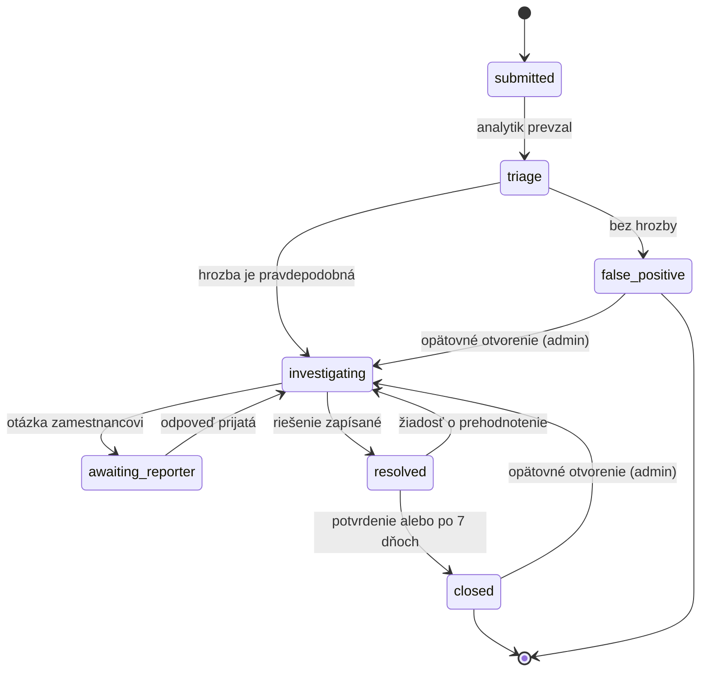

# CyberGuard — doménová špecifikácia

Verzia: návrh, 8. 11. 2026 · Autor: Vitalina (doménová expertka) · [English version](domain-specification.md)

## Účel

Tento dokument popisuje doménovú časť systému CyberGuard: polia incidentu, kategórie incidentov, závažnosť, indikátory, stavy, prístupové práva, playbooky a demo scenáre. Pokrýva body zo sekcie 12 dokumentu `project-plan.md`, ktoré treba dohodnúť pred implementáciou.

Kto čo potrebuje:

- **Architekt (Nikita):** stavy a matica práv — pre databázovú schému a API kontrakty.
- **AI expert (SaiLenT):** kategórie, škála závažnosti a indikátory — vstupy pre model (operácie Choice, Score, Noul).
- **Go vývojár:** polia incidentu a hodnoty enum polí `category`, `severity`, `status`.

## Polia incidentu

Čo sa o každom incidente ukladá, kto pole vypĺňa a kto ho môže neskôr meniť. Komentáre sú samostatná entita (pozri nižšie), nie pole incidentu.

| Pole | Význam | Povinné | Vypĺňa | Kto môže meniť |
| --- | --- | --- | --- | --- |
| `id` | Jedinečný identifikátor (UUID) | áno | systém | nikto |
| `reporter_id` | Kto incident nahlásil | áno | systém (zo session) | nikto |
| `title` | Krátky názov | áno | zamestnanec | nikto po odoslaní |
| `description` | Popis situácie | áno | zamestnanec | nikto po odoslaní |
| `affected_system` | Zasiahnutý systém (voľný text) | nie | zamestnanec | priradený analytik, admin |
| `status` | Stav incidentu | áno (`submitted`) | systém | analytik / admin, iba povolené prechody |
| `category` | Kategória | nie (`null`) | analytik | priradený analytik, admin |
| `severity` | Závažnosť | nie (`null`) | analytik | priradený analytik, admin |
| `assigned_analyst_id` | Analytik, ktorý incident rieši | nie | analytik (prevezme si ho) | admin môže preradiť |
| `resolution_note` | Čo sa urobilo a aký je výsledok | pri prechode do `resolved` | analytik | priradený analytik, admin |
| `status_reason` | Dôvod pri false positive, opätovnom otvorení alebo žiadosti o prehodnotenie | pri týchto prechodoch | ten, kto prechod vykonáva | nikto |
| `archived_at`, `archive_reason` | Archivácia (soft delete) | nie | admin | nikto |
| `created_at`, `updated_at` | Čas vytvorenia a poslednej zmeny | áno | systém | nikto |

Pravidlá:

- **Popis sa po odoslaní nedá upravovať.** Zachytáva, čo zamestnanec pôvodne nahlásil. Ďalšie informácie sa pridávajú ako komentáre.
- **Niektoré polia sú povinné až v určitom kroku.** Napríklad `resolution_note` môže zostať prázdne, kým incident nie je vyriešený, ale bez neho prechod do `resolved` nie je možný.
- **Maximálne dĺžky:** `title` 200 znakov, `description` 10 000, `affected_system` 500. Povinné polia musia obsahovať text, nielen medzery.
- **Komentáre** sú samostatná entita: incident, autor, text, čas a viditeľnosť — `public` alebo `internal`.

### Čo vidí nahlasovateľ

Nahlasovateľ je ten, kto incident odoslal, bez ohľadu na jeho rolu. Pri vlastnom incidente vidí:

| Informácia | Viditeľná pre nahlasovateľa |
| --- | --- |
| Potvrdená `category` | áno — pomôže mu hrozbu nabudúce rozpoznať |
| Potvrdená `severity` | nie — je to interná priorita fronty |
| Priradený analytik (používateľské meno) | áno |
| `resolution_note` | áno, celé — analytik ho píše pre nahlasovateľa; technické detaily patria do interných komentárov |
| Verejné komentáre | áno, a môže na ne odpovedať |
| Interné komentáre, AI návrhy, bríf | nie |

Možnosť pole čítať neznamená právo ho meniť.

## Kategórie incidentov

Navrhujeme 8 kategórií formulovaných podľa toho, čo dokáže zamestnanec sám spozorovať a opísať. Technické kategórie ako DDoS z pôvodného návrhu sme vynechali: bežný zamestnanec vidí len „stránka sa nenačíta", čo je výpadok dostupnosti.

| Kód (`category`) | Názov | Čo hlási zamestnanec | Príklad popisu |
| --- | --- | --- | --- |
| `phishing` | Phishing / sociálne inžinierstvo | Podozrivý e-mail, správa alebo hovor so žiadosťou o heslo, platbu či kliknutie na odkaz | „Prišiel mi e-mail od ‚IT oddelenia', aby som urýchlene potvrdila heslo cez odkaz" |
| `malware` | Škodlivý softvér | Zvláštne správanie počítača, vyskakovacie okná, zašifrované súbory, žiadosť o výkupné | „Po otvorení prílohy majú všetky súbory príponu .locked" |
| `account_compromise` | Kompromitácia účtu | Prihlásenie, ktoré nevykonal; zmenené heslo; e-maily odoslané v jeho mene | „Kolegovia dostali odo mňa e-maily, ktoré som nepísala" |
| `data_exposure` | Únik / vyzradenie údajov | Údaje odoslané nesprávnemu príjemcovi, zverejnené alebo vynesené | „Poslala som tabuľku s údajmi klientov nesprávnemu adresátovi" |
| `lost_device` | Strata alebo krádež zariadenia | Stratený notebook, telefón, USB kľúč s pracovnými údajmi | „Nechala som pracovný notebook vo vlaku" |
| `policy_violation` | Porušenie bezpečnostných pravidiel | Nepovolený softvér, zdieľanie hesiel, obchádzanie pravidiel | „Kolega si nainštaloval cudzí program na vzdialený prístup" |
| `service_disruption` | Výpadok dostupnosti | Nedostupný systém alebo služba s podozrením na útok | „Interný portál je nedostupný, na obrazovke je zvláštna správa" |
| `other` | Iné / nejasné | Nezodpovedá žiadnej kategórii | — |

Pravidlá:

- Jeden incident má jednu hlavnú kategóriu. Ďalšie súvislosti analytik uvedie v komentári.
- `other` je legitímna odpoveď modelu pri nízkej istote, nie chyba.
- Základ: zjednodušená ENISA Reference Incident Classification Taxonomy a kategórie VERIS.

## Závažnosť (severity)

Štyri úrovne na ordinálnej škále — vstup pre operáciu Score. Úroveň sa určuje podľa najzávažnejšieho splneného kritéria.

| Úroveň (`severity`) | Kritériá | Príklad | Cieľová prvá reakcia analytika |
| --- | --- | --- | --- |
| `critical` | Aktívny útok s plošným dopadom; zašifrované alebo vynesené kritické údaje; zastavený kľúčový systém | Ransomware na viacerých počítačoch | Okamžite |
| `high` | Kompromitované prihlasovacie údaje; vyzradené osobné alebo dôverné údaje; zasiahnutých viac používateľov | Zamestnanec zadal heslo na phishingovej stránke | V ten istý pracovný deň |
| `medium` | Zasiahnutý jeden používateľ alebo systém, existuje riziko, ale škoda nie je potvrdená | Otvorená podozrivá príloha, antivírus nič nehlási | Do 2 pracovných dní |
| `low` | Pokus bez následkov alebo porušenie bez škody | Phishingový e-mail prijatý, ale neotvorený | Podľa poradia |

Pravidlá:

- Nový incident má `severity = null`, kým ho niekto neohodnotí.
- Model úroveň iba navrhuje; konečné rozhodnutie robí analytik.
- Ak popis neuvádza znaky škody, úroveň sa automaticky neznižuje: zamestnanec si následky nemusel všimnúť.
- Čas reakcie je orientačný pre demo a dashboard, nie záväzné SLA.

## Indikátory (otázky áno/nie)

Osem úzkych otázok pre operáciu Noul. Každá overuje len to, čo je v popise **výslovne uvedené**, nie to, čo sa pravdepodobne stalo.

| Kód | Otázka k popisu | Prečo je to dôležité pre analytika | Vplyv na závažnosť |
| --- | --- | --- | --- |
| `clicked_link` | Zamestnanec uvádza, že klikol na odkaz? | Možné stiahnutie malvéru alebo zadanie údajov | ↑ na medium |
| `credentials_entered` | Zamestnanec uvádza, že zadal heslo alebo kód? | Okamžitá zmena hesla, kontrola prihlásení | ↑ na high |
| `attachment_opened` | Zamestnanec uvádza, že otvoril prílohu alebo spustil súbor? | Kontrola zariadenia na malvér | ↑ na medium |
| `payment_made` | Uvádza sa vykonaná platba alebo prevod? | Finančná škoda, kontakt s bankou | ↑ na high |
| `data_sent_out` | Uvádza sa, že údaje opustili firmu? | Možná ohlasovacia povinnosť (GDPR) | ↑ na high |
| `device_abnormal` | Je opísané nezvyčajné správanie zariadenia? | Znak malvéru | — |
| `multiple_affected` | Spomínajú sa ďalší zasiahnutí zamestnanci alebo systémy? | Rozsah, možná eskalácia | ↑ o jednu úroveň |
| `ongoing` | Opísaná aktivita stále prebieha? | Naliehavosť obmedzenia škody | ↑ o jednu úroveň |

Pravidlá:

- Pravdepodobnosť „nie" ≠ „nestalo sa". Znamená to „v popise sa to neuvádza".
- Indikátory s vysokou pravdepodobnosťou sa zvýraznia v karte incidentu a sú kandidátmi na doplňujúce otázky v brífe.
- Prahy pravdepodobnosti určí AI expert po vyhodnotení na demo dátach.

## Životný cyklus a stavy

Sedem stavov podľa modelu NIST/SANS. Sú oddelené od stavov AI úlohy (`queued`, `running`, `completed`, `failed`).

Archivácia (`archived_at`) nie je stav v toku, ale príznak soft delete: administrátor ju môže nastaviť v akomkoľvek stave s uvedením dôvodu.

| Prechod | Kto | Podmienka / čo sa zaznamená |
| --- | --- | --- |
| submitted → triage | Analyst | Analytik prevzal incident; priradenie je zaznamenané |
| triage → investigating | Analyst | Hrozba je pravdepodobná; kategória a závažnosť sú určené |
| triage → false_positive | Analyst | Hrozba neexistuje; dôvod je povinný; zamestnanec dostane notifikáciu |
| investigating → awaiting_reporter | Analyst | Zamestnancovi bola položená otázka |
| awaiting_reporter → investigating | Nahlasovateľ | Nahlasovateľ odpovedal verejným komentárom (automaticky; interné poznámky sa nepočítajú) |
| investigating → resolved | Analyst | Zaznamenané riešenie a prijaté opatrenia |
| resolved → closed | Nahlasovateľ / systém | Nahlasovateľ potvrdil, alebo automaticky po 7 dňoch bez odpovede |
| resolved → investigating | Nahlasovateľ | Nahlasovateľ požiadal o prehodnotenie s komentárom |
| closed / false_positive → investigating | Admin | Opätovné otvorenie s dôvodom |

## Matica práv

Hierarchia Employee ⊂ Analyst ⊂ Admin z plánu, rozpísaná podľa akcií. Všetky kontroly prebiehajú na backende.

| Akcia | Employee | Analyst | Admin |
| --- | --- | --- | --- |
| Vytvoriť incident | ✓ | ✓ | ✓ |
| Vidieť vlastné incidenty | ✓ | ✓ | ✓ |
| Vidieť všetky incidenty firmy | — | ✓ | ✓ |
| Doplniť informácie / odpovedať na otázku | vlastné | ✓ | ✓ |
| Čítať a písať verejné komentáre | vlastné | ✓ | ✓ |
| Čítať a písať interné komentáre | — | ✓ | ✓ |
| Vidieť AI návrhy a bríf | — | ✓ | ✓ |
| Prevziať incident (priradiť sebe) | — | ✓ | ✓ |
| Priradiť alebo preradiť iného | — | — | ✓ |
| Meniť kategóriu, závažnosť, stav | — | priradené sebe | ✓ |
| Prijať alebo opraviť AI návrh | — | priradené sebe | ✓ |
| Uzavrieť ako vyriešený / false positive | — | priradené sebe | ✓ |
| Potvrdiť riešenie alebo požiadať o prehodnotenie (vlastný incident) | ✓ | ✓ | ✓ |
| Opätovne otvoriť uzavretý incident | — | — | ✓ |
| Archivovať (soft delete s dôvodom) | — | — | ✓ |
| Spravovať používateľov a roly | — | — | ✓ |
| Vidieť auditný záznam | — | — | ✓ |
| Spustiť demo import | — | — | ✓ |

Obmedzenia:

- Zamestnanec nevidí AI odhady: sú to pracovné hypotézy analytika, nie závery pre nahlasovateľa.
- Interné komentáre zamestnanec nikdy nevidí.
- Analytik môže riešiť aj incident, ktorý sám nahlásil.
- Potvrdenie riešenia a žiadosť o prehodnotenie sú práva nahlasovateľa podľa vlastníctva incidentu, nie podľa roly.
- Analytici, ktorí nie sú k incidentu priradení, ho môžu čítať, ale nie meniť.

## Playbooky pre LLM bríf

Navrhujeme jeden krátky playbook na kategóriu (okrem `other`), 5–8 krokov, podľa schémy obmedzenie → odstránenie → obnova. LLM preberá kroky iba z nich a nevymýšľa vlastné.

Príklad — `phishing`:

1. Overiť u zamestnanca: či klikol na odkaz, zadal údaje alebo otvoril prílohu.
2. Ak zadal heslo — zmeniť heslo a ukončiť všetky aktívne relácie účtu.
3. Overiť, či rovnaký e-mail dostali aj iní zamestnanci.
4. Zablokovať odosielateľa a doménu odkazu.
5. Ak bola otvorená príloha — skontrolovať zariadenie na malvér (pokračovať playbookom `malware`).
6. Zapísať indikátory (adresa odosielateľa, doména) do komentára incidentu.
7. Oznámiť zamestnancovi výsledok a pripomenúť znaky phishingu.

Zdroje pre ďalšie playbooky (voľne dostupné):

- NIST SP 800-61 — Computer Security Incident Handling Guide.
- CISA — Federal Government Cybersecurity Incident & Vulnerability Response Playbooks.
- Model SANS PICERL (Preparation, Identification, Containment, Eradication, Recovery, Lessons learned).

Zvyšných 6 playbookov doplním po odsúhlasení kategórií.

## Demo scenáre

Desať syntetických incidentov pokrýva všetky kategórie a úrovne vrátane dvoch ťažkých prípadov pre model. Texty sú v angličtine (vstup modelu), bez skutočných hesiel a údajov.

| # | Popis zamestnanca (skrátene) | Očakávaná kategória | Očakávaná závažnosť | Čo ukazujeme |
| --- | --- | --- | --- | --- |
| 1 | Got an email from "IT support" asking to confirm my password via link, I didn't click | phishing | low | Základný scenár |
| 2 | Clicked the link in a bank email and entered my login, now unsure | phishing | high | Indikátor `credentials_entered` |
| 3 | All my files now end with .locked and there's a ransom note | malware | critical | Naliehavá eskalácia |
| 4 | Colleagues received emails from me I never sent | account_compromise | high | Kontrola prihlásení |
| 5 | Sent a spreadsheet with customer data to the wrong address | data_exposure | high | Únik bez útoku |
| 6 | Left my work laptop on the train | lost_device | medium | Incident bez útočníka |
| 7 | Coworker installed remote-access software without approval | policy_violation | medium | Porušenie pravidiel |
| 8 | Internal portal is down with a strange message on screen | service_disruption | medium | Dostupnosť |
| 9 | My computer is slow and fan is loud since this morning | other / malware | low | Nízka istota → ručné hodnotenie |
| 10 | Supplier asked to change bank details for next invoice payment | phishing | high | Podvod bez odkazu (BEC) |

Scenár pre prezentáciu: č. 2 prejde celým cyklom — nahlásenie, AI návrh, otázka zamestnancovi, úprava závažnosti analytikom, riešenie, potvrdenie.

## Prijaté rozhodnutia

| Otázka | Rozhodnutie | Kto |
| --- | --- | --- |
| Po koľkých dňoch sa `resolved` automaticky mení na `closed`? | Po 7 dňoch bez odpovede zamestnanca | Nikita |
| Môže analytik riešiť incident, ktorý sám nahlásil? | Áno | Nikita |
| Formát projektových dokumentov | Textové formáty (.md, .org), aby sa dali čítať na GitHube | Nikita |
| Jazyk dokumentácie | Predvolene angličtina; slovenská verzia môže byť uložená vedľa | Nikita |
| Maximálne dĺžky vstupov | `title` 200, `description` 10 000, `affected_system` 500 | Vitalina, Daniil |
| Čo vidí nahlasovateľ | Kategóriu, priradeného analytika, `resolution_note` a verejné komentáre; nie závažnosť, interné komentáre ani AI výstupy | Vitalina |
| Akcie nahlasovateľa | Potvrdenie / žiadosť o prehodnotenie sú práva vlastníka, pre každú rolu | Vitalina, Daniil |
| Kto mení kategóriu, závažnosť, `affected_system`, `resolution_note`, AI návrhy | Iba priradený analytik a admin | Vitalina, Daniil |
| Viditeľnosť komentárov | Dva typy: `public` a `internal` | Vitalina, Daniil |
